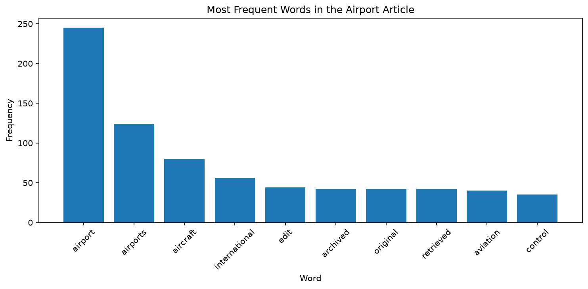
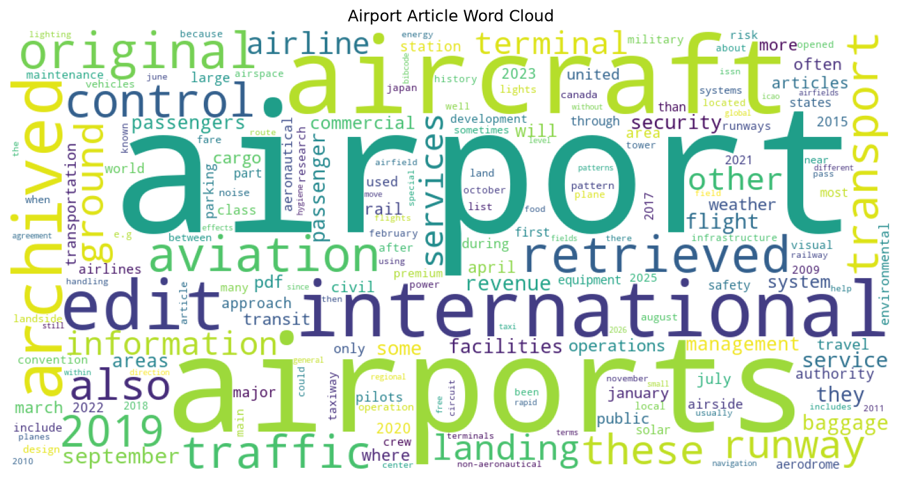

# Airport Web Text Analysis

Author: Abdellah Boudlal

Date: 2026-10

## Question

Which words occur most frequently in Wikipedia's Airport page
after basic text cleaning and filtering selected common words?

## Data

Source: [Wikipedia — Airport](https://en.wikipedia.org/wiki/Airport)

Accessed: 2026-10-23.

The analysis retrieves the page's HTML and extracts text from the
whole page, including navigation, headings, and references.
No local input dataset is required.

## Process and Tools

I adapted Denise Case's NLP example to a different topic.

- Requests downloads the HTML.
- BeautifulSoup and lxml extract the text.
- Python splits the text, converts it to lowercase, and strips
  common punctuation from the ends of tokens.
- The original length filter keeps raw tokens longer than
  three characters before punctuation is stripped.
- A set of ten common English words is filtered out.
- Polars groups the retained tokens and counts their occurrences.
- Matplotlib and WordCloud produce the visualizations.

The selected common words are from, that, with, this, have,
which, such, into, were, and their.

## Custom Application

I created a separate script, `src/nlp/airport_words.py`, changed
the source from the NLP article to the Airport article, and
updated the chart titles.

The script also saves both figures in `docs/images`.
The earlier experiment remains in `src/nlp/web_words.py`.

## Results

The observed run downloaded 579,253 characters of HTML.
It produced 11,286 raw whitespace-separated tokens and retained
7,160 tokens after cleaning and filtering.

| Word | Occurrences |
| --- | ---: |
| airport | 245 |
| airports | 124 |
| aircraft | 80 |
| international | 56 |
| edit | 44 |
| archived | 42 |
| original | 42 |
| retrieved | 42 |
| aviation | 40 |
| control | 35 |

### Frequency Chart

### Word Cloud

## Interpretation

Airport, airports, and aircraft dominate the results.
Together with aviation and control, these terms reflect the
page's focus on aviation facilities and operations.

However, edit, archived, original, and retrieved also appear
in the top 10. This shows that frequently occurring words can
come from page controls and references as well as the main text.

The results describe vocabulary in this single page.
They do not measure actual airport activity or passenger demand.

## Verification

I ran `uv run python -m nlp.airport_words`.

The script displayed both visualizations and finished with
"Pipeline executed successfully!"

## Limitations

The analysis uses one page that may change over time.
It includes navigation and reference text, and the small
stop-word list does not remove all irrelevant words.

Airport and airports are counted separately. The analysis
does not combine word forms or examine meaning and context.

## Next Steps

I would extract only the main article text and remove reference
and navigation elements. I would also compare several articles,
combine related word forms, and investigate phrases such as
air traffic control.

## Attribution and Links

Adapted from [Denise Case's original example](https://github.com/denisecase/nlp-01-getting-started).

- [My repository](https://github.com/Aboudlal/nlp-01-getting-started-custom)
- [Data source](https://en.wikipedia.org/wiki/Airport)
- [Professional Python Guide](https://denisecase.github.io/pro-analytics-02/)
